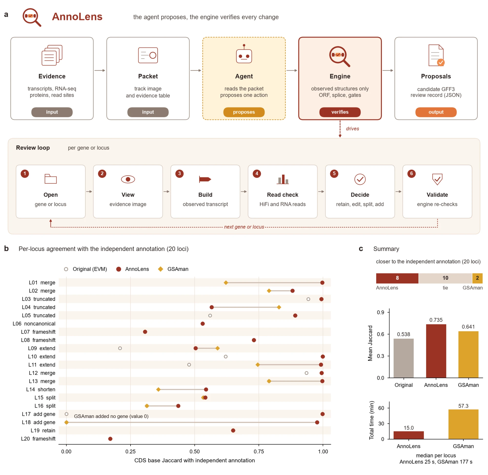

<div align="center">
  

  <p>
  <a href="pyproject.toml"></a>
  <a href="https://www.npmjs.com/package/annolens-mcp"></a>
  <a href="server.json"></a>
  <a href="LICENSE"></a>
  </p>

  No code and no commands to remember. Give an agent a gene ID or a genome position; it checks the evidence and fixes the gene model the way a human curator does.

  <a href="README.md">中文</a> | <b>English</b>
</div>

<p align="center">
  <a href="#what-it-is">What it is</a> ·
  <a href="#what-it-does">What it does</a> ·
  <a href="#getting-started">Getting started</a> ·
  <a href="#what-you-get">What you get</a> ·
  <a href="#compared-with-manual-curation">Compared with manual curation</a> ·
  <a href="#limits">Limits</a> ·
  <a href="#reference">Reference</a>
</p>

## What it is

**AnnoLens is a gene-model review and repair tool for AI agents.** Automatic annotation pipelines (EVM, BRAKER, MAKER and others) always leave some models wrong: truncated, split in two, two genes fused into one, missing a start or stop codon, without UTRs; some genes are not annotated at all. Curators fix them one by one in a genome browser such as GSAman, comparing transcripts, protein alignments and spliced reads, which takes a lot of time and expertise. AnnoLens hands this work to a vision-capable model and keeps it from making unsupported changes:

- **Evidence images**: for each gene or locus, one image (current model, transcripts per sample, protein projections, spliced reads) and a text evidence table.
- **A versioned skill decides how to review**: first the gene's extent, then its structure; when to keep, change, split, add or leave a model unresolved.
- **An engine enforces the hard rules**: candidates come only from observed transcripts or intact protein projections, and the model never writes coordinates. Complete ORF, canonical splice sites, no conflict with neighbours and evidence support are checked by the engine.
- **Proposals only**: review records and candidate GFF3; the genome and the input annotation are never edited.

It comes as an agent plugin (skill + MCP server) and a CLI, and runs entirely on your own machine.

### Who it is for

- Groups that have just annotated a genome and need to check and correct the gene models.
- Anyone who wants to cut the manual curation work in GSAman, Apollo or IGV.
- Researchers who want to ask "is this gene right?" directly in Codex, Claude Code, Cursor or another agent.

For structural annotation from scratch use an annotation pipeline such as BRAKER or MAKER; AnnoLens reviews and repairs an existing annotation.

## What it does

| Task | Example input | Result |
|---|---|---|
| **Review one gene** | "Is this gene model right? gene_123" | Decision (keep / change / split / frameshift / unresolved), evidence image, candidate GFF3 when changed |
| **Find missing genes** | "Is a gene missing at chr3:1,204,000-1,212,000?" | A new gene, or "not a coding gene" |
| **Merge and split** | "Were these two neighbouring genes originally one?" | A validated merged model, or several separate genes |
| **Assembly error or real frameshift** | "Is the frameshift here an assembly error?" | HiFi and RNA read counts and a conclusion |
| **Genome-wide check** | The whole annotation | Rule checks of every gene (coding completeness, UTRs, overlaps, truncation, fusion and more), ranked into review queues |
| **Batch review** | A queue name or a gene list | One record per gene and a summary; works with any vision-capable model behind an OpenAI- or Anthropic-compatible API |

## Getting started

### Agent plugin

Send this sentence to Codex, Claude Code, Cursor, WorkBuddy or another agent:

```text
Install or update this plugin for me: https://github.com/forageseed/AnnoLens
```

The agent follows [AGENTS.md](AGENTS.md): it installs the Python package, registers the MCP server and installs the skill. Then check the machine:

```bash
annolens check
```

and describe the task in plain words, for example:

```text
Is this gene model right? gene_123
```

```text
Review the first 20 genes of the queue and summarise.
```

### CLI / MCP

Python 3.11 or newer on Linux, macOS or WSL on Windows. Install and set up a project:

```bash
python -m pip install git+https://github.com/forageseed/AnnoLens.git
annolens check
annolens prepare --manifest annolens.toml --threads 16    # work dir: junctions, protein projections, read sites
annolens scan    --manifest annolens.toml                 # genome-wide rule check, builds the review queues
```

Copy the manifest from [`examples/annolens.toml`](examples/annolens.toml): genome, annotation, RNA alignments, protein sets, and optionally long-read transcripts, HiFi reads, a repeat annotation and a model API. Protein projections need miniprot; samples with a BAM but no GTF also need StringTie.

An MCP client needs one command (standard configuration in [`.mcp.json`](.mcp.json)):

```json
{ "mcpServers": { "annolens": { "command": "annolens", "args": ["mcp"] } } }
```

The project comes from the environment variable `ANNOLENS_MANIFEST`, or `annolens.toml` in the directory the server starts in. To register and install the skill in one step: `annolens install --host codex|claude|cursor|generic --manifest annolens.toml`.

Batch review outside a chat (API keys are read from environment variables only):

```bash
annolens review  --manifest annolens.toml --queue P1 --workers 4
annolens addgene --manifest annolens.toml --queue missing_high --workers 4
```

## What you get

- **Decisions:** one review record (JSON) per gene or locus with decision, confidence, rationale and evidence gaps.
- **Candidate models:** changed, split and added genes as GFF3 (with UTRs), each validated by the engine.
- **Evidence images:** attached in the chat for manual checking.
- **Read checks:** HiFi and RNA read counts at any position, separating assembly errors from real frameshifts or stops.
- **Queues and summaries:** ranked queues from the genome-wide check, decision counts from batch review.

## Compared with manual curation



Figure: (a) the AnnoLens framework, where the agent proposes and the engine verifies each change, one gene or locus per loop; (b) per-locus agreement with the independent annotation for 20 loci; (c) summary.

Twenty loci from one genome, covering nine kinds of problem: truncation, extension, merge, split, shortening, non-canonical splicing, genome frameshift, missing gene and controls. AnnoLens (skill v3.8, GLM model) reviewed them automatically. GSAman was operated through its GUI by an agent that could not see the AnnoLens results; this is not an experienced human curator, who may be faster. The reference is an independent annotation of the same species, not ground truth.

| Measure | AnnoLens | GSAman |
|---|---|---|
| CDS base overlap with the independent annotation (Jaccard, mean; original 0.538) | **0.735** | 0.641 |
| Loci closer to the independent annotation (10 tied) | **8** | 2 |
| Total time | **15.0 min** | 57.3 min |
| Time per locus (median) | **25 s** | 177 s |
| BUSCO completeness, embryophyta (original 98.8%) | **99.6%** | — |
| BUSCO completeness, fabales (original 98.8%) | **99.3%** | — |

By problem type:
- Extending truncated models, merging neighbours and adding genes mostly gave identical models.
- Splitting fused genes (2 loci), merges that depend on the reading frame, and a minus-strand new gene were beyond GSAman's longest-ORF prediction. AnnoLens matched the independent annotation in all of them.
- At 1 locus GSAman extended further, because the AnnoLens evidence gate did not pass that candidate.
- At 1 locus GSAman deleted a neighbouring gene by mistake.
- Both kept the original model at the non-canonical splice and genome frameshift loci.

The acceptance rule found in this comparison is part of skill v3.8: a complete ORF that several samples agree on can prove that the original model is truncated.

## Limits

- Linux, macOS or WSL: the engine reads BAM files with pysam, which has no native Windows build.
- The host model must read images; with the text evidence table only, decisions are weaker.
- Evidence sets the ceiling: without any transcript or intact protein supporting a structure, AnnoLens does not invent one but reports unresolved and what evidence is missing.
- Non-canonical splice sites are never adopted automatically and need manual review.
- Output is proposals only; you decide what goes into the final annotation, and the genome and original annotation are never changed.
- Batch review calls the model API you configure and costs money; in an agent chat the host model does the review.

## Reference

<details>
<summary>The three protein roles</summary>

| role | Meaning | Use |
|---|---|---|
| `independent` | Another annotation of the same species, made independently | Anchors start, stop and length; main reference for truncation |
| `related` | Proteome of a related species | Anchors start, stop and length |
| `paralog` | Proteins from the same pipeline as the annotation under review (e.g. homeologs) | Supports introns only |

Do not set the protein set that was used as annotation evidence as `independent`: it repeats the same truncations.
</details>

<details>
<summary>Decisions</summary>

| Existing gene | Meaning |
|---|---|
| `retain` | The current model is complete and supported |
| `recommend_candidate` | Adopt a new structure validated by the engine |
| `split` | The model fuses two or more genes; split into validated genes |
| `genome_frameshift` | Reads confirm that this genome carries the frameshift or stop an independent protein needs; the model is kept and flagged |
| `assembly_conflict` | An assembly problem (gap, misjoin, or reads disagree with the assembly) |
| `unresolved` | Conflicting evidence |

| Locus without a model | Meaning |
|---|---|
| `add_gene` | A new gene validated by the engine |
| `no_gene` | Not a protein-coding gene (transposon, non-coding transcript or too little evidence) |
| `genome_frameshift` | The gene is disabled in this genome |
| `unresolved` | Cannot be decided |
</details>

<details>
<summary>Design</summary>

- **Structures come only from observed evidence**: the model chooses which transcript, which ATG or which projection, never coordinates.
- **Evidence gates**: a full-chain long read; or supported introns with start, stop and length anchored by a protein projection; or the ORF most samples agree on. At least one is required.
- **Fix only what is broken**: a complete, supported model is not replaced, except with a truncation proof. That proof needs a protein of matching length, an original under 90 % of it, and start and stop anchored by a projection or by an ORF that at least 5 samples agree on.
- **Anti-truncation**: a candidate shorter than the dominant ORF and seen in fewer samples is refused.
- **Traceable**: every candidate carries content, engine and input hashes; when evidence or code change, old candidates are invalid.
</details>

<details>
<summary>Skill package, sub-agents and MCP tools</summary>

```
skills/annolens/
  SKILL.md                    when to use it, how to connect, the workflow
  references/gene-policy.md   policy for existing gene models (incl. split)
  references/locus-policy.md  policy for loci without a model (add gene)
  references/decisions.md     decisions and the machine rules behind them
  references/tools.md         MCP tool reference
  references/setup.md         install and connection
  scripts/check_gff.py        deterministic checks without MCP (any GFF3 + FASTA)
agents/annolens-curator.md    sub-agent: review one gene or locus
agents/annolens-batch.md      sub-agent: review a queue and summarise
commands/                     /annolens-review, /annolens-addgene, /annolens-queue
```

| Step | Existing gene | Locus without a model |
|---|---|---|
| List a queue | `annolens_list_queue` | `annolens_list_queue` |
| Open | `annolens_open_gene` | `annolens_open_locus` |
| Change window | `annolens_gene_view` | `annolens_locus_view` |
| List ORFs | `annolens_gene_orfs` | `annolens_locus_orfs` |
| Build a candidate | `annolens_gene_build` | `annolens_locus_build` |
| Split (one part at a time) | `annolens_gene_split_part` | — |
| Read check | `annolens_readcheck` | `annolens_readcheck` |
| Decide | `annolens_gene_decide` | `annolens_locus_decide` |

Also prompts `annolens_review_gene`, `annolens_add_gene` and resources `annolens://skill/gene`, `annolens://skill/locus`.
</details>

<details>
<summary>Install channels and layout</summary>

| Channel | Use |
|---|---|
| In a chat | "Install or update this plugin for me: https://github.com/forageseed/AnnoLens" |
| pip | `python -m pip install git+https://github.com/forageseed/AnnoLens.git`, then `annolens install --host <host>` |
| npm | `npx -y annolens-mcp install --host <host>` (needs the Python package above) |
| Claude Code plugin | `/plugin marketplace add forageseed/AnnoLens`, then `/plugin install annolens@annolens` |
| Codex plugin | `.codex-plugin/` in the repository |
| Skill only | `npx skills add forageseed/AnnoLens` |

```
annolens/            Python package (engine, session, mcp_server, check, install, ...)
annolens/skills/     versioned skill texts (gene_v3.8; v3.7 and v3.5 kept; locus_v3.6)
examples/            example project manifest
skills/ agents/ commands/   skill package, sub-agents, slash commands
.mcp.json .claude-plugin/ .codex-plugin/ server.json npm/   host adapters
AGENTS.md            install instructions for agents
```
</details>

## Citation and license

Paper in preparation. License: [Apache-2.0](LICENSE).
