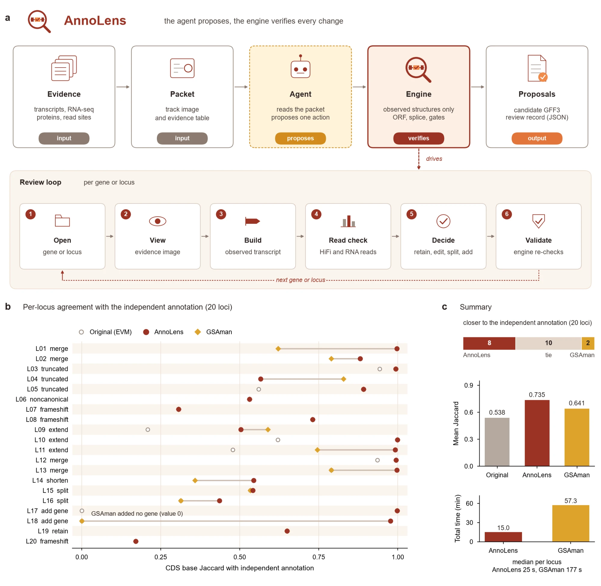

<div align="center">
  

  <p>
  <a href="pyproject.toml"></a>
  <a href="https://www.npmjs.com/package/annolens-mcp"></a>
  <a href="server.json"></a>
  <a href="LICENSE"></a>
  </p>

  不用写代码，也不用记命令。把基因 ID 或基因组位置交给 Agent，它像人工审阅员一样看证据、修基因模型。

  <b>中文</b> | <a href="README.en.md">English</a>
</div>

<p align="center">
  <a href="#这是什么">这是什么</a> ·
  <a href="#能做什么">能做什么</a> ·
  <a href="#开始使用">开始使用</a> ·
  <a href="#你会得到什么">你会得到什么</a> ·
  <a href="#与人工审阅对比">与人工审阅对比</a> ·
  <a href="#使用边界">使用边界</a> ·
  <a href="#进阶参考">进阶参考</a>
</p>

## 这是什么

**AnnoLens 是面向 AI Agent 的基因模型审阅与修复工具**。自动注释流程（EVM、BRAKER、MAKER 等）给出的基因模型里，总有一部分有问题：截短、被拆成两段、两个基因被并成一个、缺起始或终止密码子、没有 UTR；还有一些基因根本没被注释出来。人工审阅员会在基因组浏览器里对照转录本、同源蛋白和剪接读段，逐个改正，例如用 GSAman，这非常耗费人力和专业判断。AnnoLens 把这个过程交给能看图的大模型，同时保证它不能乱改：

- **看证据图做判断**：每个基因或位点一张证据图（当前模型、各样本转录本、同源蛋白投影、剪接读段）和一份文字证据表。
- **技能规定怎么审**：先定基因范围，再定结构；什么时候保留、修改、拆分、新增或判为无法判断，都写在版本化的技能里。
- **引擎守住硬规则**：候选只能取自观测转录本或完整同源投影，模型不能自己写坐标；完整 ORF、经典剪接、不与邻基因冲突、证据支持等由引擎检查。
- **只提建议，不改原件**：输出审阅记录和候选 GFF3，基因组和输入注释都不会被修改。

它提供 Agent 插件（技能 + MCP Server）和 CLI 两种入口，全部在你自己的电脑上运行。

### 适合谁

- 刚做完基因组注释、需要检查和修正基因模型的课题组。
- 想把人工审阅（GSAman、Apollo、IGV 手工修改）的工作量降下来的人。
- 需要在 Codex、Claude Code、Cursor 等 Agent 里直接问“这个基因对不对”的研究者。

如果你需要的是从零做结构注释，请用 BRAKER、MAKER 等注释流程；AnnoLens 审阅和修复已有注释。

## 能做什么

| 任务 | 输入示例 | 结果 |
|---|---|---|
| **审一个基因** | “这个基因模型对吗？gene_123” | 结论（保留 / 修改 / 拆分 / 移码 / 无法判断）、证据图，修改时附候选 GFF3 |
| **找漏注释的基因** | “chr3:1,204,000–1,212,000 是不是漏了一个基因？” | 新增基因或“不是编码基因”的结论 |
| **合并与拆分** | “这两个相邻基因是不是本来是一个？” | 经验证的合并模型，或拆成多个独立基因 |
| **区分组装错误和真实移码** | “这个位置的移码是组装错误吗？” | HiFi 与 RNA 读段计数和结论 |
| **全基因组初查** | 整套注释 | 每个基因的规则检查（编码完整性、UTR、重叠、截短、融合等），按优先级排成待审队列 |
| **批量审阅** | 队列名或基因列表 | 逐个审阅记录和汇总；可接任何兼容 OpenAI / Anthropic 接口、能看图的模型 |

## 开始使用

### Agent 插件

将下面这句话发给 Codex、Claude Code、Cursor、WorkBuddy 等 Agent：

```text
帮我安装或更新这个插件：https://github.com/forageseed/AnnoLens
```

Agent 会按仓库里的 [AGENTS.md](AGENTS.md) 安装 Python 包、登记 MCP 服务并装好技能。安装完成后，先检查本机环境：

```bash
annolens check
```

然后直接描述任务，例如：

```text
这个基因模型对吗？gene_123
```

```text
把待审队列里的前 20 个基因审一遍，最后汇总一下。
```

### CLI / MCP

需要 Python 3.11 或更新版本，Linux、macOS 或 Windows 的 WSL。安装和一个项目的完整流程：

```bash
python -m pip install git+https://github.com/forageseed/AnnoLens.git
annolens check
annolens prepare --manifest annolens.toml --threads 16    # 生成工作目录（剪接、同源投影、读段位点）
annolens scan    --manifest annolens.toml                 # 全基因组规则初查，生成待审队列
```

项目清单从 [`examples/annolens.toml`](examples/annolens.toml) 复制修改：基因组、注释、RNA 比对、同源蛋白，可选长读长转录本、HiFi、重复序列注释和模型接口。同源投影需要 miniprot；只有 BAM 没有 GTF 的样本还需要 StringTie。

接入支持 MCP 的客户端只需要一条命令（标准配置见 [`.mcp.json`](.mcp.json)）：

```json
{ "mcpServers": { "annolens": { "command": "annolens", "args": ["mcp"] } } }
```

项目路径取自环境变量 `ANNOLENS_MANIFEST`，没有设置时用启动目录下的 `annolens.toml`。也可以一步登记并装技能：`annolens install --host codex|claude|cursor|generic --manifest annolens.toml`。

不在对话里、要成批审阅时（模型密钥只从环境变量读取）：

```bash
annolens review  --manifest annolens.toml --queue P1 --workers 4
annolens addgene --manifest annolens.toml --queue missing_high --workers 4
```

## 你会得到什么

- **结论**：每个基因或位点一条审阅记录（JSON），写明结论、置信度、理由和证据缺口。
- **候选模型**：修改、拆分和新增的基因输出为 GFF3（含 UTR），每个都经过引擎验证。
- **证据图**：对话里直接附上，便于人工复核。
- **读段核查**：任意位置的 HiFi 与 RNA 读段计数，区分组装错误与真实移码或终止。
- **队列与汇总**：全基因组初查的分级队列，批量审阅的结论统计。

## 与人工审阅对比



上图：a 为 AnnoLens 框架（代理提议、引擎逐项验证，审阅循环每次处理一个基因或位点）；b 为 20 个位点与独立注释的一致性；c 为汇总。

同一套基因组上选 20 个位点，覆盖截短、延伸、合并、拆分、缩短、非经典剪接、基因组移码、漏注释和对照共 9 类问题。AnnoLens（技能 v3.8，GLM 模型）自动审阅；GSAman 由 Agent 操作其图形界面逐个修改，操作时看不到 AnnoLens 的结果（不是资深人工审阅员，熟练的人可能更快）。参照为同物种另一套独立注释（不是绝对真值）。

| 指标 | AnnoLens | GSAman |
|---|---|---|
| 与独立注释的 CDS 碱基重合（Jaccard，均值；原注释 0.538） | **0.735** | 0.641 |
| 更接近独立注释的位点数（其余 10 个持平） | **8** | 2 |
| 合计用时 | **15.0 分钟** | 57.3 分钟 |
| 每个位点用时（中位数） | **25 秒** | 177 秒 |
| BUSCO 完整度，embryophyta（原注释 98.8%） | **99.6%** | — |
| BUSCO 完整度，fabales（原注释 98.8%） | **99.3%** | — |

分类型看：
- 截短的延长、相邻基因合并、新增基因，两者大多给出完全相同的模型。
- 拆分融合基因（2 个）、需要读阅读框才能判断的合并、负链新增基因，GSAman 的最长 ORF 预测做不出来，AnnoLens 都给出了与独立注释一致的结果。
- GSAman 在 1 个位点延长得更多（AnnoLens 证据门控没有放行）。
- GSAman 在 1 个位点误删了相邻基因。
- 非经典剪接和基因组移码，两者都保留原模型。

这次对比中发现的放行条件已经并入技能 v3.8：多个样本一致的完整 ORF 可以证明原模型被截短。

## 使用边界

- 需要 Linux、macOS 或 WSL：引擎用 pysam 读 BAM，pysam 没有 Windows 原生版本。
- 需要宿主模型能看图；只有文字证据表时，判断能力会下降。
- 证据决定上限：某个结构没有任何转录本或完整同源蛋白支持时，AnnoLens 不会凭空构建，而是判为无法判断并写明缺什么证据。
- 非经典剪接位点不会被自动采纳，需要人工复核。
- 它只输出建议：最终注释是否采纳由你决定，基因组和原注释不会被改动。
- 批量审阅会调用你配置的模型接口并产生费用；在 Agent 对话里使用时由宿主模型完成审阅。

## 进阶参考

<details>
<summary>同源蛋白的三种角色</summary>

| role | 含义 | 用法 |
|---|---|---|
| `independent` | 同一物种另一套独立产生的注释 | 锚定起点、终点和长度；判断截短的主要参照 |
| `related` | 近缘种蛋白组 | 锚定起点、终点和长度 |
| `paralog` | 与被审注释出自同一流程的蛋白，例如同源拷贝 | 只支持内含子 |

不要把当初用作注释证据的蛋白组设为 `independent`：它会重复注释里同样的截短。
</details>

<details>
<summary>结论类型</summary>

| 已有基因 | 含义 |
|---|---|
| `retain` | 当前模型完整，且有证据支持 |
| `recommend_candidate` | 采用经引擎验证的新结构 |
| `split` | 原模型是融合基因，拆成两个或多个经验证的基因 |
| `genome_frameshift` | 独立蛋白需要的移码或终止被读段证实确实存在于本基因组；保留原模型并标记 |
| `assembly_conflict` | 组装层面的问题（缺口、错接，或读段显示组装有误） |
| `unresolved` | 证据冲突，无法判断 |

| 无模型位点 | 含义 |
|---|---|
| `add_gene` | 新增经引擎验证的基因 |
| `no_gene` | 不是蛋白编码基因（转座子、非编码转录本或证据不足） |
| `genome_frameshift` | 该基因在本基因组中已经失活 |
| `unresolved` | 无法判断 |
</details>

<details>
<summary>设计要点</summary>

- **结构只能取自观测证据**：模型只能选“用哪条转录本”“哪个 ATG”“哪条同源投影”，不能直接写坐标。
- **证据门控**：长读长全链支持；或内含子有读段支持、起止和长度有同源投影锚定；或多数样本一致的主导 ORF。至少满足一条才能采纳。
- **只修确实有问题的模型**：完整且已有证据支持的模型不被替换；例外是截短证明，即有长度相符的同源蛋白、原模型不足其 90%，且起止由同源投影或至少 5 个样本一致的主导 ORF 锚定。
- **防截短**：比主导 ORF 短、支持样本也更少的候选不能采纳。
- **可追溯**：每个候选带内容哈希、引擎哈希和输入指纹；证据或代码一变，旧候选自动作废。
</details>

<details>
<summary>技能包、子 agent 与 MCP 工具</summary>

```
skills/annolens/
  SKILL.md                    什么时候用、怎么连接、工作流程
  references/gene-policy.md   已有基因的审阅策略（含拆分）
  references/locus-policy.md  缺失位点的新增基因策略
  references/decisions.md     各类结论的含义和机器规则
  references/tools.md         MCP 工具参考
  references/setup.md         安装与连接
  scripts/check_gff.py        不依赖 MCP 的确定性检查（任意 GFF3 + FASTA）
agents/annolens-curator.md    子 agent：审一个基因或位点
agents/annolens-batch.md      子 agent：审一个队列并汇总
commands/                     /annolens-review、/annolens-addgene、/annolens-queue
```

| 步骤 | 已有基因 | 无模型位点 |
|---|---|---|
| 列队列 | `annolens_list_queue` | `annolens_list_queue` |
| 打开 | `annolens_open_gene` | `annolens_open_locus` |
| 换窗口 | `annolens_gene_view` | `annolens_locus_view` |
| 列 ORF | `annolens_gene_orfs` | `annolens_locus_orfs` |
| 构建候选 | `annolens_gene_build` | `annolens_locus_build` |
| 拆分（逐段构建） | `annolens_gene_split_part` | — |
| 读段核查 | `annolens_readcheck` | `annolens_readcheck` |
| 下结论 | `annolens_gene_decide` | `annolens_locus_decide` |

另有提示词 `annolens_review_gene`、`annolens_add_gene`，资源 `annolens://skill/gene`、`annolens://skill/locus`。
</details>

<details>
<summary>安装渠道与目录</summary>

| 渠道 | 用法 |
|---|---|
| 在对话里 | “帮我安装或更新这个插件：https://github.com/forageseed/AnnoLens” |
| pip | `python -m pip install git+https://github.com/forageseed/AnnoLens.git`，再 `annolens install --host <宿主>` |
| npm | `npx -y annolens-mcp install --host <宿主>`（需已装上面的 Python 包） |
| Claude Code 插件 | `/plugin marketplace add forageseed/AnnoLens`，再 `/plugin install annolens@annolens` |
| Codex 插件 | 仓库中的 `.codex-plugin/` |
| 只装技能 | `npx skills add forageseed/AnnoLens` |

```
annolens/            Python 包（engine、session、mcp_server、check、install 等）
annolens/skills/     版本化技能文本（gene_v3.8；旧版 v3.7、v3.5 保留；locus_v3.6）
examples/            项目清单示例
skills/ agents/ commands/   技能包、子 agent、斜杠命令
.mcp.json .claude-plugin/ .codex-plugin/ server.json npm/   各宿主接入
AGENTS.md            给 Agent 的安装说明
```
</details>

## 引用与许可

论文准备中。许可证：[Apache-2.0](LICENSE)。
